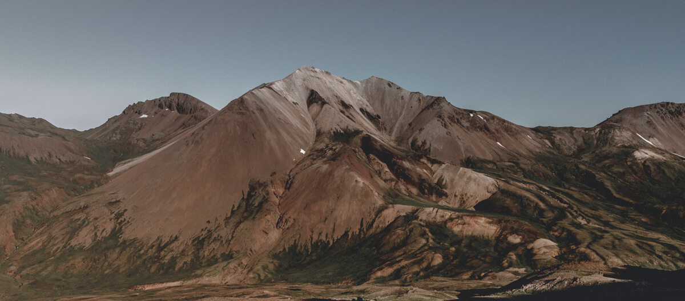

Add a picture to this page's **Page Media**, then place it with ``. An italic line right below it becomes its caption.

*Replace this picture and caption with your own – and credit its source here*

> [!TIP]
> A callout like this one starts with `> [!TIP]`. There's also `[!NOTE]`, `[!IMPORTANT]`, `[!WARNING]` and `[!CAUTION]`.
